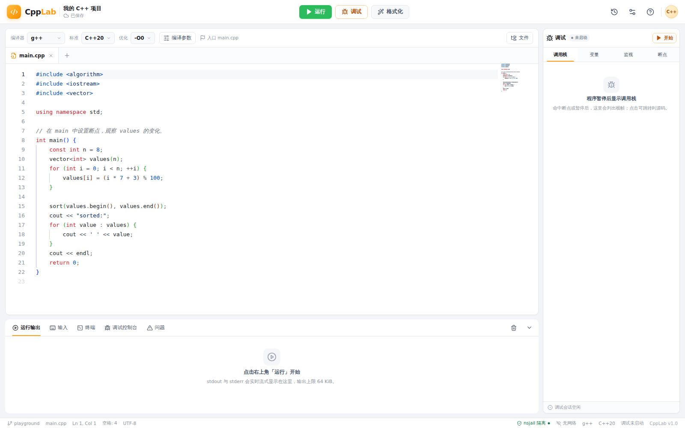
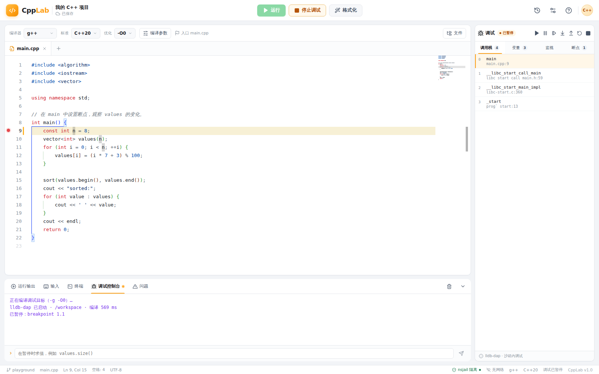

# CppLab · 在线 C++ IDE

一个单机部署的在线 C++ 编辑 / 编译 / 运行 / 图形化调试平台。界面参考力扣的浅色工作台风格，
后端是单进程 Node.js 服务，所有用户代码（包括编译阶段）都在 nsjail 中执行。





## 功能

- **编辑**：Monaco Editor、C++ 高亮、括号匹配、自动缩进、代码折叠、minimap、C++ snippet 补全。
- **多文件**：文件 Tab、新建 / 删除 / 切换入口文件，自动保存到 SQLite。
- **编译运行**：g++ / clang++、C++17/20/23、优化级别、编译参数白名单、stdin、流式 stdout/stderr。
- **诊断**：解析 `file:line:col: error:` 诊断，写入 Monaco markers；“问题”面板点击可跳转。
- **格式化**：`clang-format` 在沙箱内执行，使用内置 Google 风格（4 空格、列宽 100）。
- **图形化调试**：lldb-dap + DAP over WebSocket；行断点、当前行高亮、调用栈、懒加载变量树、
  Watch、调试控制台 REPL、继续 / 暂停 / 单步跳过 / 步入 / 步出 / 重启 / 停止。
- **运行历史**：每次运行保存源码快照、参数、输出与状态；可恢复任意一次运行的代码。
- **隔离**：nsjail（namespaces + cgroup v2 + rlimits + seccomp）、无网络、只读根文件系统、
  每任务独立工作区、进程组回收、输出上限、并发信号量与按 IP 限流。

## 快速开始

环境要求：Linux、Node.js ≥ 22.5（推荐 24）、可用的 `sudo`。`node:sqlite` 从 Node 22.5
起内置，项目不使用原生扩展。已在 WSL2 / Ubuntu 26.04 验证通过。

```bash
npm install                 # 首次安装依赖
npm run sandbox:setup       # 安装 clang / lldb / clang-format / dumb-init，构建并安装 nsjail，创建设备节点（会调用 sudo）
npm run build               # 构建前端到 dist/client，后端到 dist/server.js
npm start                   # 单进程启动，默认 http://127.0.0.1:3000
```

开发模式（Vite 热更新 + tsx 后端）：

```bash
npm run dev                 # 前端 http://127.0.0.1:5173，API/WS 代理到 3000
```

> `sandbox:setup` 会把 `nsjail` 安装为 `4755`（setuid root），并创建 4 个设备节点到
> `data/sandbox/dev/`。这是单机单用户/内网场景的简化；如果宿主机上还有其他不受信任的本地用户，
> 建议改为由 root 启动后端，并把 nsjail 恢复为普通权限。详见“安全说明与环境差异”。

### 环境变量

| 变量 | 默认值 | 说明 |
|---|---|---|
| `HOST` | `127.0.0.1` | 监听地址；需要局域网访问时设为 `0.0.0.0`（无内置认证） |
| `PORT` | `3000` | HTTP/WebSocket 端口 |
| `DB_PATH` | `data/cpplab.db` | SQLite 路径 |
| `WORK_ROOT` | `$TMPDIR/cpplab-work` | 每次任务的临时工作区根目录；建议放在 tmpfs |
| `NSJAIL_PATH` | 自动探测 | nsjail 可执行文件 |
| `LLDB_DAP_PATH` | 自动探测 | lldb-dap 路径 |
| `DUMB_INIT_PATH` | 自动探测 | dumb-init 路径（缺失时直接 exec） |
| `CLANG_FORMAT_PATH` | 自动探测 | clang-format 路径 |
| `CLANGXX_PATH` | 自动探测 | clang++ 路径 |

## 架构

```text
浏览器（React + Monaco + DAP Client）
  ├─ REST：项目/文件、格式化、运行请求、历史
  └─ WebSocket：运行输出流、DAP 调试通道
                │
                ▼
Node.js 单进程（Express + ws + node:sqlite）
  ├─ Semaphore：编译 ≤2 / 运行 ≤4 / 调试 ≤2
  ├─ 编译：nsjail → dumb-init → g++/clang++ → /workspace/prog
  ├─ 运行：nsjail → dumb-init → /usr/bin/time → /workspace/prog
  ├─ 调试：nsjail → dumb-init → lldb-dap（stdio ↔ DAP WebSocket）
  └─ 限流：按 IP 1 req/s，突发 5
```

### 目录

```text
服务端代码位于 src/server：
  main.ts                 Express 路由、WS upgrade、生命周期
  runService.ts            运行会话、事件流、并发控制
  sandbox/nsjail.ts        nsjail 启动、超时、杀进程组、输出截断
  sandbox/config/*.cfg     编译 / 运行 / 调试三份 nsjail 配置
  compile/flags.ts         编译参数白名单（argv 数组，绝不拼 shell）
  compile/diagnostics.ts   g++/clang++ 诊断解析
  compile/runner.ts        编译、运行、格式化
  debug/session.ts         DAP 会话、空闲/硬超时、协议桥
  db.ts                    SQLite 项目 / 文件 / 运行 / 调试会话

src/client：
  App.tsx                  工作台状态与交互
  components/              TopBar、编辑器、底部面板、调试侧栏、历史抽屉、弹窗
  editor/monaco.ts         主题、C++ snippet、语言配置
  debug/dapClient.ts       DAP 客户端状态机、请求超时、懒加载
  styles/app.css           力扣风格视觉系统
```

### API 摘要

| 方法 | 路径 | 用途 |
|---|---|---|
| `GET` | `/api/health` | 能力探测（编译器 / 沙箱 / 格式化 / 调试器） |
| `GET` | `/api/project` | 项目、文件、能力 |
| `PATCH` | `/api/project` | 更新入口 / 编译器 / 标准 / 优化 / 名称 |
| `POST` | `/api/files` | 保存单个文件 |
| `DELETE` | `/api/files/*` | 删除文件（入口与最后一个文件不可删） |
| `POST` | `/api/format` | 沙箱内 clang-format |
| `POST` | `/api/run` | 202 + `runId` + `wsPath` |
| `GET` | `/api/runs` | 运行历史摘要 |
| `GET` | `/api/runs/:id` | 历史详情（含源码快照） |
| `POST` | `/api/runs/:id/restore` | 恢复历史快照 |
| `POST` | `/api/debug/start` | 编译并创建调试会话 |
| `POST` | `/api/debug/:id/stop` | 主动结束调试 |
| `WS` | `/ws/run/:runId` | 运行阶段 / stdout / stderr / 最终结果 |
| `WS` | `/ws/debug/:sessionId` | 裸 DAP JSON 帧 |

## 安全模型

[`AGENTS.md`](AGENTS.md) §3「安全底线清单」的 7 条底线在本实现中的落点：

1. **编译也在沙箱内**：`compileWorkspace` 与运行走同一套 nsjail 启动器，使用编译专用 cgroup 配额。
2. **编译参数白名单**：只允许 `-g/-Wall/-Wextra/-Werror/-pthread/-lm/-D/-I/` 指定 sanitizer；
   `-o`、`@file`、`-fplugin`、`-wrapper`、`-Xclang`、`-include` 等显式拒绝。
3. **输出上限**：父进程计数 stdout+stderr，超过 `outputBytes`（默认 64 KiB）立即终止进程树并标记 `OLE`。
4. **杀进程组**：`setsid` 启动 nsjail，watchdog 先 SIGTERM 整个进程组，再按 `/proc` 父子关系 SIGKILL，
   避免 pid namespace 里的 init 残留。
5. **无网络**：nsjail 默认创建新 network namespace；没有接口、没有路由。
6. **只读 rootfs + 独立工作区**：`/usr` 只读 bind，`/workspace` 是每次任务新建的目录，
   jail 内 `/tmp`、`/dev/shm` 是 tmpfs；根文件系统目录权限为 0555。`WORK_ROOT` 建议放在
   tmpfs 上，使容量上限由内核直接强制。
7. **no-new-privs + 非 root**：nsjail 默认 `no_new_privs`，jail 内 uid/gid = 10000，capabilities 丢弃；`dumb-init` 作为 PID 1 转发信号。

其他措施：

- 每次运行/调试独立临时目录，结束即删除；调试有 5 分钟空闲、30 分钟硬超时、1 小时 nsjail 兜底。
- 伪造 `/etc/passwd`、`/etc/group`，不挂载宿主 `/home`、`/root`。
- seccomp 黑名单覆盖 `mount/umount2/pivot_root/chroot/bpf/userfaultfd/io_uring` 等；
  调试配置额外放开 `ptrace`。
- 运行请求校验文件数、总源码大小、stdin、编译器枚举、标志白名单；SQLite 只存文本。
- 审计日志写入 `data/runtime/audit.log`（运行开始/结束、调试开始/结束、源码哈希）。

### 安全说明与环境差异

本项目按既定设计实现，以下是为适配特定内核版本与本地工具链所做的取舍，均已在代码注释中说明：

| 设计 | 实现 | 原因 |
|---|---|---|
| 调试 `pids_max=32` | `256` | LLVM 21 的 lldb-dap 线程池在 32 个任务时 `pthread_create` 失败 |
| rootfs remount 为只读 | `--rw` + rootfs 目录 0555 / 文件 0444 | 当前内核在 setuid nsjail 的 user namespace 中 remount 宿主 bind 返回 EPERM；目录权限仍阻止写入 |
| `/dev/*` 由 tmpfs 注入 | 宿主 `data/sandbox/dev` 设备节点 bind | 设备节点在 userns 中若是外部 uid，`open(O_CREAT)` 会 EACCES |
| 调试 seccomp 只移除 `ptrace` | 同时允许 `setuid/setgid/setresuid/setresgid` | lldb 的 fork launcher 会调用 `setgid(getgid())`，否则被 SIGSYS |
| `socket()` 应失败 | 允许创建 socket，但 `connect()` 无路由 | Linux 空网络命名空间允许创建 socket；无网络目标已由 netns 保证 |

其他限制：

- 单用户/内网使用，**没有登录与权限系统**。默认只监听 `127.0.0.1`；不要直接暴露到公网。
- setuid nsjail 意味着宿主机上的任意本地用户都能执行 nsjail；多用户宿主建议由 root 运行后端。
- 运行工作区位于宿主 `WORK_ROOT`。如果它不是 tmpfs，`fsize`、任务生命周期与清理仍会约束磁盘，
  但不像真正的 per-task tmpfs 那样由内核强制容量上限。
- 调试 MVP **不支持交互式 stdin**。读取 `std::cin` 的程序调试时会等待输入，请先用“输入”面板
  验证逻辑，或改为固定输入再调试。
- 未实现 clangd LSP、条件断点、`setVariable`、多线程 UI、`rr` 反向调试——这些属于后续/可选范围。
- 沙箱的隔离上限仍是宿主内核 syscall 面；威胁模型接受这一点。

## 资源限制（默认）

| 项 | 编译 | 运行 | 调试 |
|---|---|---|---|
| 墙钟 | 20 s | 0.2–10 s（默认 2 s） | 30 min 硬超时 |
| 内存 | 1024 MiB | 64–512 MiB（默认 256） | 1024 MiB |
| pids | 64 | 14 | 256 |
| 输出 | 512 KiB | 64 KiB | DAP 帧 ≤8 MiB |
| 文件大小 | 256 MiB | 16 MiB | 1 GiB |
| nofile | 256 | 100 | 256 |
| 并发 | 2 | 4 | 2 |

## 测试

```bash
npm run build
node scripts/smoke-test.mjs
```

脚本会启动一个隔离的后端实例（临时 SQLite + 工作目录），执行 15 项检查：

```text
✓ backend and sandbox ready
✓ project bootstrap
✓ sandboxed compile and run
✓ compile diagnostics
✓ wall-clock timeout and process-group cleanup
✓ output cap
✓ cgroup memory limit
✓ fake /etc/passwd inside jail
✓ host include path unavailable
✓ network namespace has no route
✓ compiler flag allowlist
✓ multi-file project
✓ clang-format sandboxed formatting
✓ DAP breakpoint, stack, variables and program output
✓ SQLite history and snapshot restore
15 checks passed.
```

更多手动验收清单见 [`tests/sandbox/README.md`](tests/sandbox/README.md) 和
[`tests/debug/README.md`](tests/debug/README.md)。

## 快捷键

| 快捷键 | 行为 |
|---|---|
| `Ctrl/⌘ + Enter` | 运行 |
| `F5` | 启动调试 / 继续 / 暂停 |
| `Shift + F5` | 停止调试 |
| `F9` | 当前行切换断点 |
| `F10` / `F11` / `Shift + F11` | 单步跳过 / 步入 / 步出 |
| `Ctrl/⌘ + S` | 立即保存 |
| `Ctrl/⌘ + Shift + F` | clang-format 格式化 |

## 已知问题

- 调试会话中程序 `std::cin` 会等待（见上）。
- 断点所在行被 LLVM 映射到下一行时，断点列表保留用户设置的行号，但“已验证”状态会更新；
  当前执行行以调试器返回的栈帧为准。
- `socket()` 本身不会失败；验收以连接失败为准。
- 运行/调试失败时优先看底部“运行输出”与“调试控制台”；编译错误看“问题”面板。

## 参考

- 界面风格：力扣（LeetCode）风格
- Monaco、nsjail、DAP、lldb-dap 的边界与约束见 [`AGENTS.md`](AGENTS.md)
