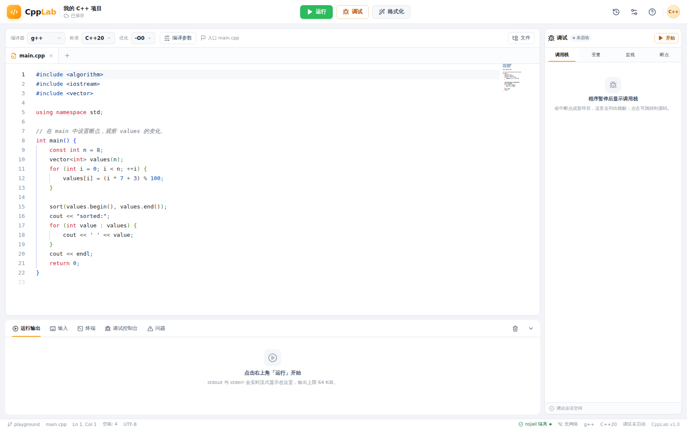
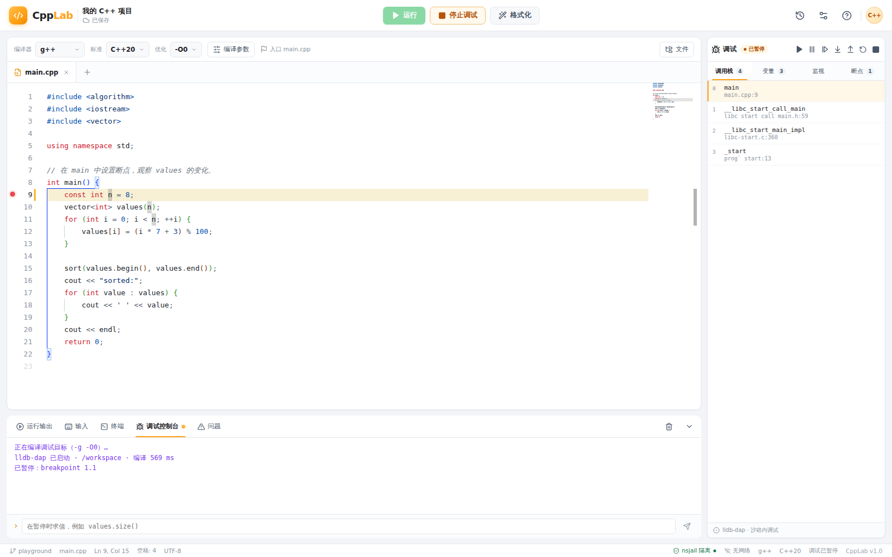

# CppLab · 在线 C++ IDE

一个单机部署的在线 C++ 编辑 / 编译 / 运行 / 图形化调试平台。界面参考力扣的浅色工作台风格，
后端是单进程 Node.js 服务，所有用户代码（包括编译阶段）都在 nsjail 中执行。





## 功能

- **编辑**：Monaco Editor、C++ 高亮、括号匹配、自动缩进、代码折叠、minimap、C++ snippet 补全。
- **多文件**：文件 Tab、新建 / 删除 / 切换入口文件，自动保存到 SQLite。
- **编译运行**：g++ / clang++、C++17/20/23、优化级别、编译参数白名单、stdin、流式 stdout/stderr。
- **诊断**：解析 `file:line:col: error:` 诊断，写入 Monaco markers；“问题”面板点击可跳转。
- **格式化**：`clang-format` 在沙箱内执行，使用内置 Google 风格（4 空格、列宽 100）。
- **图形化调试**：lldb-dap + DAP over WebSocket；行断点、当前行高亮、调用栈、懒加载变量树、
  Watch、调试控制台 REPL、继续 / 暂停 / 单步跳过 / 步入 / 步出 / 重启 / 停止。
  右侧调试面板可调整宽度、可折叠，宽度与折叠状态都会记住。
- **运行历史**：每次运行保存源码快照、参数、输出与状态；可恢复任意一次运行的代码。
- **双语界面**：前后端共用一份消息目录（英文 / 中文），API 错误、运行阶段与沙箱提示和界面同语言；
  首次访问跟随浏览器语言，随时可在「设置 → 界面语言」切换（存 `localStorage`）。
- **多用户账号**：管理员通过 CLI 创建本地账号（不开放注册）；scrypt 密码、服务端会话、
  HttpOnly `SameSite=Strict` Cookie、强制改密；项目、历史与调试会话按账号隔离。
- **隔离**：nsjail（namespaces + cgroup v2 + rlimits + seccomp）、无网络、只读根文件系统、
  每任务独立工作区、进程组回收、输出上限、全局与按账号并发上限、限流。

## 快速开始

环境要求：Linux、Node.js ≥ 22.5（推荐 24）、可用的 `sudo`。`node:sqlite` 从 Node 22.5
起内置，项目不使用原生扩展。已在 WSL2 / Ubuntu 26.04 验证通过。

```bash
npm install                 # 首次安装依赖
npm run sandbox:setup       # 安装 clang / lldb / clang-format / dumb-init，构建并安装 nsjail，创建设备节点（会调用 sudo）
npm run build               # 构建前端到 dist/client，后端到 dist/server.js
npm run user:add -- alice --admin   # 创建第一个管理员（交互式输入密码）
npm start                   # 单进程启动，默认 http://127.0.0.1:3000
```

不开放匿名注册：首个账号由 CLI 创建，之后可用 `npm run user:add` 或 `POST /api/admin/users`。
如果旧数据库里已有 `playground` 项目，**第一个**账号会自动继承它。

开发模式（Vite 热更新 + tsx 后端）：

```bash
npm run dev                 # 前端 http://127.0.0.1:5173，API/WS 代理到 3000
```

> `sandbox:setup` 会把 `nsjail` 安装为 `4755`（setuid root），并创建 4 个设备节点到
> `data/sandbox/dev/`。这是单机/内网场景的简化；如果宿主机上还有其他不受信任的本地用户，
> 建议改为由 root 启动后端，并把 nsjail 恢复为普通权限。详见“安全说明与环境差异”。

### 环境变量

| 变量 | 默认值 | 说明 |
|---|---|---|
| `HOST` | `127.0.0.1` | 监听地址；仅在 HTTPS 或受信内网中设为 `0.0.0.0` |
| `PORT` | `3000` | HTTP/WebSocket 端口 |
| `DB_PATH` | `data/cpplab.db` | SQLite 路径（含密码哈希与会话） |
| `WORK_ROOT` | `$TMPDIR/cpplab-work` | 每次任务的临时工作区根目录；建议放在 tmpfs |
| `NSJAIL_PATH` | 自动探测 | nsjail 可执行文件 |
| `LLDB_DAP_PATH` | 自动探测 | lldb-dap 路径 |
| `DUMB_INIT_PATH` | 自动探测 | dumb-init 路径（缺失时直接 exec） |
| `CLANG_FORMAT_PATH` | 自动探测 | clang-format 路径 |
| `CLANGXX_PATH` | 自动探测 | clang++ 路径 |
| `SESSION_IDLE_HOURS` | `8` | 会话空闲超时 |
| `SESSION_ABSOLUTE_DAYS` | `7` | 会话绝对有效期 |
| `COOKIE_SECURE` | `auto` | `auto` 仅 HTTPS 请求加 Secure；可设 `always` / `never` |
| `TRUST_PROXY` | `0` | 可信反向代理跳数；**不要**设为 `true`（会让 IP 限流失效） |
| `PUBLIC_ORIGIN` | — | 反代后浏览器可见的 origin，如 `https://cpp.example.com`，用于 Origin 校验 |
| `ALLOW_BOOTSTRAP` | `0` | 一次性引导：`users` 为空时用 `BOOTSTRAP_ADMIN_*` 创建首个管理员 |
| `BOOTSTRAP_ADMIN_USERNAME` / `BOOTSTRAP_ADMIN_PASSWORD` | — | 仅 `ALLOW_BOOTSTRAP=1` 时读取；不会写入日志 |

### 账号、传输与反向代理

```bash
npm run user:add -- alice --admin    # 创建管理员（交互式输入密码）
npm run user:add -- bob              # 普通用户
npm run user:list
npm run user:passwd -- bob           # 重置：打印一次性密码并强制下次改密
npm run user:disable -- bob          # 也可 user:enable / user:role
```

- 启动时会把 `data/` 收紧到 `0700`、SQLite 文件收紧到 `0600`；升级前请先备份数据库
  （里面有密码哈希与源码快照）。
- 局域网/公网使用必须放在 HTTPS 反向代理之后：设置 `TRUST_PROXY=1`、
  `PUBLIC_ORIGIN=https://your.site`，`COOKIE_SECURE` 保持 `auto`（或强制 `always`）。
  代理必须转发 `Cookie` 与 `Origin` 头并升级 WebSocket，否则 API 会返回 `403 CSRF_ORIGIN`、
  WebSocket 登录失败。
- 非浏览器 API 客户端在所有 `POST` / `PATCH` / `DELETE` 请求上都必须带 `Content-Type:
  application/json` 与和站点同源的 `Origin` 头，这是 CSRF 防护的一部分。
- `TRUST_PROXY` 是跳数而不是布尔值。一层 nginx/Caddy 就设 `1`，Express 才会读取
  `X-Forwarded-For` / `X-Forwarded-Proto`；设为 `true` 会接受伪造的客户端 IP，使按 IP 的
  登录限流失效。

## 架构

```text
浏览器（React + Monaco + DAP Client）
  ├─ REST：项目/文件、格式化、运行请求、历史
  └─ WebSocket：运行输出流、DAP 调试通道
                │
                ▼
Node.js 单进程（Express + ws + node:sqlite）
  ├─ 认证：scrypt 密码、auth_sessions（只存 token 哈希）、HttpOnly Cookie、Origin/CSRF 校验
  ├─ 授权：所有项目/运行/调试查询都限定在当前账号
  ├─ Semaphore：编译 ≤2 / 运行 ≤4 / 调试 ≤2，并按账号限制 ≤1 运行 / ≤1 调试
  ├─ 编译：nsjail → dumb-init → g++/clang++ → /workspace/prog
  ├─ 运行：nsjail → dumb-init → /usr/bin/time → /workspace/prog
  ├─ 调试：nsjail → dumb-init → lldb-dap（stdio ↔ DAP WebSocket）
  └─ 限流：按 IP 1 req/s（突发 5）、按账号、登录 IP/用户名窗口 + 退避
```

### 目录

```text
服务端代码位于 src/server：
  main.ts                 Express 路由、WS upgrade、生命周期
  runService.ts            运行会话、事件流、并发控制
  sandbox/nsjail.ts        nsjail 启动、超时、杀进程组、输出截断
  sandbox/config/*.cfg     编译 / 运行 / 调试三份 nsjail 配置
  compile/flags.ts         编译参数白名单（argv 数组，绝不拼 shell）
  compile/diagnostics.ts   g++/clang++ 诊断解析
  compile/runner.ts        编译、运行、格式化
  debug/session.ts         DAP 会话、空闲/硬超时、协议桥
  auth/                    密码哈希、会话/Cookie、登录限流、中间件、认证服务
  db.ts                    SQLite 用户 / 会话 / 项目 / 文件 / 运行 / 调试会话

src/client：
  App.tsx                  工作台状态与交互
  components/              TopBar、编辑器、底部面板、调试侧栏、历史抽屉、弹窗
  editor/monaco.ts         主题、C++ snippet、语言配置
  debug/dapClient.ts       DAP 客户端状态机、请求超时、懒加载
  components/AuthScreens.tsx  登录、强制改密、账号弹窗
  storage.ts              按账号隔离 localStorage
  styles/app.css           力扣风格视觉系统

scripts/user-cli.mts      本地账号管理 CLI
```

### API 摘要

| 方法 | 路径 | 用途 |
|---|---|---|
| `GET` | `/api/health` | 公开能力探测（不含会话数据） |
| `POST` | `/api/auth/login` | 公开登录（8 KiB 请求体，IP + 用户名限流） |
| `GET` | `/api/auth/me` | 当前用户（脱敏） |
| `POST` | `/api/auth/logout` | 撤销当前会话 |
| `POST` | `/api/auth/password` | 校验旧密码、撤销其他会话、轮换 Cookie |
| `GET/POST/PATCH` | `/api/admin/users[...]` | 管理员创建 / 列表 / 禁用启用 / 改角色 / 重置密码 |
| `GET` | `/api/project` | 当前账号的项目、文件、能力 |
| `PATCH` | `/api/project` | 更新入口 / 编译器 / 标准 / 优化 / 名称 |
| `POST` | `/api/files` | 保存单个文件 |
| `DELETE` | `/api/files/*` | 删除文件（入口与最后一个文件不可删） |
| `POST` | `/api/format` | 沙箱内 clang-format |
| `POST` | `/api/run` | 202 + `runId` + `wsPath` |
| `GET` | `/api/runs` | 运行历史摘要 |
| `GET` | `/api/runs/:id` | 历史详情（含源码快照） |
| `POST` | `/api/runs/:id/restore` | 恢复历史快照 |
| `POST` | `/api/debug/start` | 编译并创建调试会话 |
| `POST` | `/api/debug/:id/stop` | 主动结束调试 |
| `WS` | `/ws/run/:runId` | 运行阶段 / stdout / stderr / 最终结果 |
| `WS` | `/ws/debug/:sessionId` | 裸 DAP JSON 帧 |

除健康检查与登录外，所有 `/api/*` 都需要有效会话 Cookie。跨账号资源统一返回 `404`（而非
`403`），避免探测 ID 是否存在。WebSocket 升级会校验 Cookie 与运行/调试归属；关闭码为
`4401`（未登录）、`4403`（非 owner）、`4404`（不存在）。

## 安全模型

[`AGENTS.md`](AGENTS.md) §3「安全底线清单」的 7 条底线在本实现中的落点：

1. **编译也在沙箱内**：`compileWorkspace` 与运行走同一套 nsjail 启动器，使用编译专用 cgroup 配额。
2. **编译参数白名单**：只允许 `-g/-Wall/-Wextra/-Werror/-pthread/-lm/-D/-I/` 指定 sanitizer；
   `-o`、`@file`、`-fplugin`、`-wrapper`、`-Xclang`、`-include` 等显式拒绝。
3. **输出上限**：父进程计数 stdout+stderr，超过 `outputBytes`（默认 64 KiB）立即终止进程树并标记 `OLE`。
4. **杀进程组**：`setsid` 启动 nsjail，watchdog 先 SIGTERM 整个进程组，再按 `/proc` 父子关系 SIGKILL，
   避免 pid namespace 里的 init 残留。
5. **无网络**：nsjail 默认创建新 network namespace；没有接口、没有路由。
6. **只读 rootfs + 独立工作区**：`/usr` 只读 bind，`/workspace` 是每次任务新建的目录，
   jail 内 `/tmp`、`/dev/shm` 是 tmpfs；根文件系统目录权限为 0555。`WORK_ROOT` 建议放在
   tmpfs 上，使容量上限由内核直接强制。
7. **no-new-privs + 非 root**：nsjail 默认 `no_new_privs`，jail 内 uid/gid = 10000，capabilities 丢弃；`dumb-init` 作为 PID 1 转发信号。

多用户层：

- **密码**：Node 内置 `scrypt`（N=32768，r=8，p=1），每个密码独立盐、自描述哈希格式，
  参数升级后下次登录自动 rehash；未知用户名同样执行一次 scrypt，避免时序枚举。
- **会话**：32 字节随机 token，只存 SHA-256；HttpOnly、`SameSite=Strict`、`Path=/`、
  HTTPS 下 `Secure`；空闲 8 小时 / 绝对 7 天。登录必轮换，改密与管理员禁用撤销全部会话。
- **CSRF**：所有非 GET `/api` 请求（含登录）必须带同源 `Origin`；WebSocket 升级同样校验。
- **授权**：客户端从不传 projectId；所有查询使用当前账号自己的项目，运行/调试会话带
  `ownerId`；跨账号一律 `404`/`4403`。
- **公平性**：在全局信号量之上加按账号运行/调试槽（`USER_BUSY` / `DEBUG_BUSY`）、
  按账号请求限流与登录退避。
- **存储**：`data/` 为 `0700`，DB/WAL/SHM 为 `0600`；只存 token 哈希与 scrypt 哈希；
  审计日志单行限长并按 10 MiB × 5 轮转。

其他措施：

- 每次运行/调试独立临时目录，结束即删除；调试有 5 分钟空闲、30 分钟硬超时、1 小时 nsjail 兜底。
- 伪造 `/etc/passwd`、`/etc/group`，不挂载宿主 `/home`、`/root`。
- seccomp 黑名单覆盖 `mount/umount2/pivot_root/chroot/bpf/userfaultfd/io_uring` 等；
  调试配置额外放开 `ptrace`。
- 运行请求校验文件数、总源码大小、stdin、编译器枚举、标志白名单；SQLite 只存文本。
- 审计日志写入 `data/runtime/audit.log`（登录成功/失败、会话撤销、用户变更、运行/调试生命周期、
  源码哈希）；绝不记录密码、token 与完整请求体。

### 安全说明与环境差异

本项目按既定设计实现，以下是为适配特定内核版本与本地工具链所做的取舍，均已在代码注释中说明：

| 设计 | 实现 | 原因 |
|---|---|---|
| 调试 `pids_max=32` | `256` | LLVM 21 的 lldb-dap 线程池在 32 个任务时 `pthread_create` 失败 |
| rootfs remount 为只读 | `--rw` + rootfs 目录 0555 / 文件 0444 | 当前内核在 setuid nsjail 的 user namespace 中 remount 宿主 bind 返回 EPERM；目录权限仍阻止写入 |
| `/dev/*` 由 tmpfs 注入 | 宿主 `data/sandbox/dev` 设备节点 bind | 设备节点在 userns 中若是外部 uid，`open(O_CREAT)` 会 EACCES |
| 调试 seccomp 只移除 `ptrace` | 同时允许 `setuid/setgid/setresuid/setresgid` | lldb 的 fork launcher 会调用 `setgid(getgid())`，否则被 SIGSYS |
| `socket()` 应失败 | 允许创建 socket，但 `connect()` 无路由 | Linux 空网络命名空间允许创建 socket；无网络目标已由 netns 保证 |

其他限制：

- 账号由管理员创建；没有自助注册、邮件找回、OIDC/LDAP 或多项目 UI。管理员默认不能读取
  他人源码。
- 局域网明文 HTTP 会暴露密码与会话 Cookie；请使用 HTTPS 反向代理，或 `127.0.0.1` + SSH 隧道。
  默认只监听 `127.0.0.1`。
- setuid nsjail 意味着宿主机上的任意本地用户都能执行 nsjail；多用户宿主建议由 root 运行后端。
- 运行工作区位于宿主 `WORK_ROOT`。如果它不是 tmpfs，`fsize`、任务生命周期与清理仍会约束磁盘，
  但不像真正的 per-task tmpfs 那样由内核强制容量上限。
- 调试 MVP **不支持交互式 stdin**。读取 `std::cin` 的程序调试时会等待输入，请先用“输入”面板
  验证逻辑，或改为固定输入再调试。
- 未实现 clangd LSP、条件断点、`setVariable`、多线程 UI、`rr` 反向调试——这些属于后续/可选范围。
- 沙箱的隔离上限仍是宿主内核 syscall 面；威胁模型接受这一点。

## 资源限制（默认）

| 项 | 编译 | 运行 | 调试 |
|---|---|---|---|
| 墙钟 | 20 s | 0.2–10 s（默认 2 s） | 30 min 硬超时 |
| 内存 | 1024 MiB | 64–512 MiB（默认 256） | 1024 MiB |
| pids | 64 | 14 | 256 |
| 输出 | 512 KiB | 64 KiB | DAP 帧 ≤8 MiB |
| 文件大小 | 256 MiB | 16 MiB | 1 GiB |
| nofile | 256 | 100 | 256 |
| 并发 | 2 | 4 | 2 |
| 每账号并发 | — | 1 | 1 |

## 测试

```bash
npm run build
node scripts/smoke-test.mjs
```

```bash
npm run test:unit           # 密码/会话/授权/迁移单元测试（node --test + tsx）
npm test                    # 端到端冒烟测试（需先 npm run build）
```

脚本会启动隔离后端（临时 SQLite + 工作目录），通过环境变量引导管理员并**真实登录**（没有
跳过鉴权的后门），执行 25 项检查：

```text
✓ backend and sandbox ready
✓ unauthenticated access and Origin enforcement
✓ login, uniform failure and HttpOnly session cookie
✓ token/password hashes at rest and 0700/0600 permissions
✓ project bootstrap for the signed-in user
✓ admin-created account and separate personal project
✓ per-user run slot returns USER_BUSY while a run is active
✓ sandboxed compile and run
✓ cross-user run/restore access returns 404 and WS close 4403
✓ compile diagnostics
✓ wall-clock timeout and process-group cleanup
✓ output cap
✓ cgroup memory limit
✓ fake /etc/passwd inside jail
✓ host include path unavailable
✓ network namespace has no route
✓ compiler flag allowlist
✓ multi-file project
✓ clang-format sandboxed formatting
✓ DAP breakpoint, stack, variables and cross-user rejection
✓ SQLite history and snapshot restore
✓ forced password change blocks the workspace until completed
✓ password change revokes the old session and issues a new one
✓ logout clears the cookie and invalidates the session
✓ login flood is rate-limited
25 checks passed.
```

本地化有两项专属检查：

```bash
npm run i18n:check          # 校验中英目录 key 与占位符一致，且 src / scripts / tests 无未翻译文案
# UI_USERNAME / UI_PASSWORD 指向运行中后端上的真实账号
BASE_URL=http://127.0.0.1:3000 UI_USERNAME=alice UI_PASSWORD=... npm run i18n:ui
```

更多手动验收清单见 [`tests/sandbox/README.md`](tests/sandbox/README.md) 和
[`tests/debug/README.md`](tests/debug/README.md)。

## 快捷键

| 快捷键 | 行为 |
|---|---|
| `Ctrl/⌘ + Enter` | 运行 |
| `F5` | 启动调试 / 继续 / 暂停 |
| `Shift + F5` | 停止调试 |
| `F9` | 当前行切换断点 |
| `F10` / `F11` / `Shift + F11` | 单步跳过 / 步入 / 步出 |
| `Ctrl/⌘ + S` | 立即保存 |
| `Ctrl/⌘ + Shift + F` | clang-format 格式化 |

## 已知问题

- 调试会话中程序 `std::cin` 会等待（见上）。
- 断点所在行被 LLVM 映射到下一行时，断点列表保留用户设置的行号，但“已验证”状态会更新；
  当前执行行以调试器返回的栈帧为准。
- `socket()` 本身不会失败；验收以连接失败为准。
- 运行/调试失败时优先看底部“运行输出”与“调试控制台”；编译错误看“问题”面板。

## 参考

- 界面风格：力扣（LeetCode）风格
- Monaco、nsjail、DAP、lldb-dap 的边界与约束见 [`AGENTS.md`](AGENTS.md)
