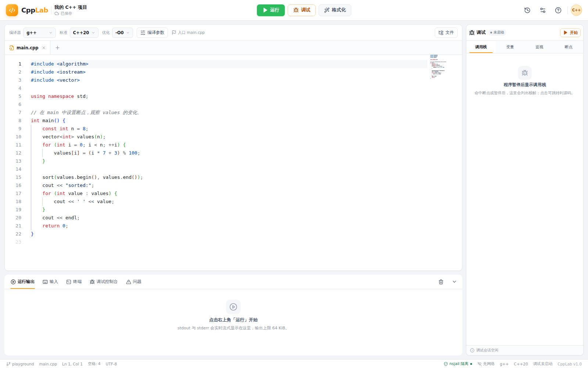
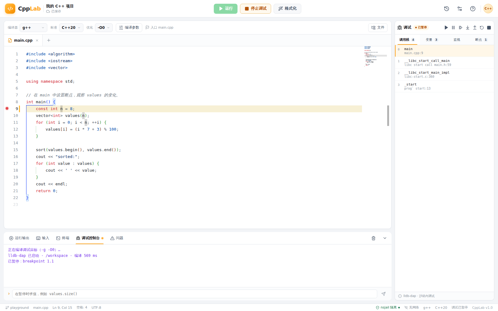

# CppLab · Online C++ IDE

A self-hosted online C++ edit / compile / run / graphical-debug platform. The UI follows a
LeetCode-style light workbench look; the backend is a single-process Node.js service, and all
user code (including the compile step) runs inside nsjail.

> **中文文档**: [README-zh_CN.md](README-zh_CN.md)





## Features

- **Editing**: Monaco Editor with C++ highlighting, bracket matching, auto-indent, code folding,
  minimap, and C++ snippet completion.
- **Multi-file**: file tabs, create / delete / switch the entry file, auto-saved to SQLite.
- **Compile & run**: g++ / clang++, C++17/20/23, optimization levels, a compiler-flag allowlist,
  stdin, streaming stdout/stderr.
- **Diagnostics**: parses `file:line:col: error:` diagnostics into Monaco markers; the
  "Problems" panel jumps to the location on click.
- **Formatting**: `clang-format` executed inside the sandbox with the built-in Google style
  (4 spaces, column limit 100).
- **Graphical debugging**: lldb-dap + DAP over WebSocket; line breakpoints, current-line
  highlight, call stack, lazily-loaded variable tree, Watch, debug-console REPL, and
  continue / pause / step over / step into / step out / restart / stop.
- **Run history**: every run stores a source snapshot, arguments, output, and status; any past
  run's code can be restored.
- **Isolation**: nsjail (namespaces + cgroup v2 + rlimits + seccomp), no network, read-only root
  filesystem, a fresh workspace per task, process-group reaping, output caps, concurrency
  semaphores, and per-IP rate limiting.

## Quick start

Requirements: Linux, Node.js ≥ 22.5 (24 recommended), and a working `sudo`. `node:sqlite` is
built in from Node 22.5 on; the project uses no native addons. Verified on WSL2 / Ubuntu 26.04.

```bash
npm install                 # install dependencies
npm run sandbox:setup       # install clang / lldb / clang-format / dumb-init, build & install nsjail, create device nodes (calls sudo)
npm run build               # build the client to dist/client and the server to dist/server.js
npm start                   # single-process start, default http://127.0.0.1:3000
```

Development mode (Vite HMR + tsx backend):

```bash
npm run dev                 # client at http://127.0.0.1:5173, API/WS proxied to 3000
```

> `sandbox:setup` installs `nsjail` as `4755` (setuid root) and creates 4 device nodes under
> `data/sandbox/dev/`. This is a simplification for a single-machine, single-user / intranet
> setup; if there are other untrusted local users on the host, prefer running the backend as
> root and restoring nsjail to normal permissions. See "Security notes & environment
> differences".

### Environment variables

| Variable | Default | Description |
|---|---|---|
| `HOST` | `127.0.0.1` | Listen address; set `0.0.0.0` for LAN access (no built-in auth) |
| `PORT` | `3000` | HTTP/WebSocket port |
| `DB_PATH` | `data/cpplab.db` | SQLite path |
| `WORK_ROOT` | `$TMPDIR/cpplab-work` | Root of per-task scratch workspaces; tmpfs recommended |
| `NSJAIL_PATH` | auto-detect | nsjail executable |
| `LLDB_DAP_PATH` | auto-detect | lldb-dap path |
| `DUMB_INIT_PATH` | auto-detect | dumb-init path (exec directly if missing) |
| `CLANG_FORMAT_PATH` | auto-detect | clang-format path |
| `CLANGXX_PATH` | auto-detect | clang++ path |

## Architecture

```text
Browser (React + Monaco + DAP Client)
  ├─ REST: project/files, format, run requests, history
  └─ WebSocket: run output stream, DAP debug channel
                │
                ▼
Single-process Node.js (Express + ws + node:sqlite)
  ├─ Semaphore: compile ≤2 / run ≤4 / debug ≤2
  ├─ Compile: nsjail → dumb-init → g++/clang++ → /workspace/prog
  ├─ Run:     nsjail → dumb-init → /usr/bin/time → /workspace/prog
  ├─ Debug:   nsjail → dumb-init → lldb-dap (stdio ↔ DAP WebSocket)
  └─ Rate limit: per IP 1 req/s, burst 5
```

### Directory layout

```text
Server code lives in src/server:
  main.ts                 Express routes, WS upgrade, lifecycle
  runService.ts           run sessions, event stream, concurrency control
  sandbox/nsjail.ts       nsjail launch, timeouts, process-group kill, output truncation
  sandbox/config/*.cfg    three nsjail configs: compile / run / debug
  compile/flags.ts        compiler-flag allowlist (argv arrays, never shell strings)
  compile/diagnostics.ts  g++/clang++ diagnostic parsing
  compile/runner.ts       compile, run, format
  debug/session.ts        DAP sessions, idle/hard timeouts, protocol bridge
  db.ts                   SQLite projects / files / runs / debug sessions

src/client:
  App.tsx                 workbench state and interactions
  components/             TopBar, editor, bottom panel, debug sidebar, history drawer, dialogs
  editor/monaco.ts        theme, C++ snippets, language configuration
  debug/dapClient.ts      DAP client state machine, request timeouts, lazy loading
  styles/app.css          LeetCode-style visual system
```

### API summary

| Method | Path | Purpose |
|---|---|---|
| `GET` | `/api/health` | capability probe (compiler / sandbox / formatter / debugger) |
| `GET` | `/api/project` | project, files, capabilities |
| `PATCH` | `/api/project` | update entry / compiler / standard / optimization / name |
| `POST` | `/api/files` | save a single file |
| `DELETE` | `/api/files/*` | delete a file (entry file and the last file are protected) |
| `POST` | `/api/format` | clang-format inside the sandbox |
| `POST` | `/api/run` | 202 + `runId` + `wsPath` |
| `GET` | `/api/runs` | run-history summaries |
| `GET` | `/api/runs/:id` | run detail (including source snapshot) |
| `POST` | `/api/runs/:id/restore` | restore a historical snapshot |
| `POST` | `/api/debug/start` | compile and create a debug session |
| `POST` | `/api/debug/:id/stop` | end a debug session explicitly |
| `WS` | `/ws/run/:runId` | run phases / stdout / stderr / final result |
| `WS` | `/ws/debug/:sessionId` | raw DAP JSON frames |

## Security model

Where the seven non-negotiable items of [`AGENTS.md`](AGENTS.md) §3 land in this
implementation:

1. **Compilation also runs in the sandbox**: `compileWorkspace` uses the same nsjail launcher as
   the run path, with compile-specific cgroup quotas.
2. **Compiler-flag allowlist**: only `-g/-Wall/-Wextra/-Werror/-pthread/-lm/-D/-I/` plus the
   specified sanitizers are accepted; `-o`, `@file`, `-fplugin`, `-wrapper`, `-Xclang`,
   `-include`, etc. are explicitly rejected.
3. **Output cap**: the parent counts stdout+stderr and terminates the process tree immediately
   past `outputBytes` (64 KiB by default), marking the run `OLE`.
4. **Kill the process group**: nsjail is started with `setsid`; the watchdog first SIGTERMs the
   whole process group, then SIGKILLs by `/proc` parent-child relations so no init inside the
   pid namespace is left behind.
5. **No network**: nsjail creates a fresh network namespace by default — no interfaces, no
   routes.
6. **Read-only rootfs + per-task workspace**: `/usr` is a read-only bind, `/workspace` is a
   directory created per task, and `/tmp` / `/dev/shm` inside the jail are tmpfs; rootfs
   directories are mode 0555. Put `WORK_ROOT` on a tmpfs so the capacity limit is enforced by
   the kernel directly.
7. **no-new-privs + non-root**: nsjail enables `no_new_privs` by default, uid/gid inside the
   jail is 10000, capabilities are dropped; `dumb-init` acts as PID 1 forwarding signals.

Additional measures:

- A fresh temporary directory per run/debug task, removed on completion; debug sessions get a
  5-minute idle timeout, a 30-minute hard timeout, and a 1-hour nsjail backstop.
- Forged `/etc/passwd` and `/etc/group`; host `/home` and `/root` are never mounted.
- A seccomp denylist covering `mount/umount2/pivot_root/chroot/bpf/userfaultfd/io_uring` etc.;
  the debug config additionally allows `ptrace`.
- Run requests are validated for file count, total source size, stdin size, compiler enum, and
  the flag allowlist; SQLite stores text only.
- Audit log written to `data/runtime/audit.log` (run start/end, debug start/end, source hash).

### Security notes & environment differences

The project follows its intended design; the following are trade-offs made for specific kernel
versions and local toolchains, each explained in code comments:

| Design | Implementation | Reason |
|---|---|---|
| Debug `pids_max=32` | `256` | LLVM 21's lldb-dap thread pool fails `pthread_create` at 32 tasks |
| rootfs remounted read-only | `--rw` + rootfs dirs 0555 / files 0444 | On the current kernel, remounting a host bind inside a setuid nsjail user namespace returns EPERM; directory modes still prevent writes |
| `/dev/*` injected as tmpfs | bind host `data/sandbox/dev` device nodes | Device nodes owned by an outside uid in a userns cause `open(O_CREAT)` to return EACCES |
| Debug seccomp only lifts `ptrace` | also allows `setuid/setgid/setresuid/setresgid` | lldb's fork launcher calls `setgid(getgid())`, otherwise killed by SIGSYS |
| `socket()` should fail | socket creation allowed, `connect()` has no route | An empty Linux network namespace permits creating sockets; the no-network goal is guaranteed by the netns |

Other limitations:

- Single-user / intranet use, **no login or permission system**. Listens on `127.0.0.1` by
  default; do not expose it directly to the public internet.
- setuid nsjail means any local user on the host can execute nsjail; on multi-user hosts
  prefer running the backend as root.
- Run workspaces live under the host `WORK_ROOT`. If it is not a tmpfs, `fsize`, task
  lifecycle, and cleanup still bound disk usage, but capacity is not kernel-enforced the way a
  true per-task tmpfs is.
- The debug MVP does **not support interactive stdin**. Programs reading `std::cin` will block
  while debugging — validate the logic via the "Input" panel first, or switch to fixed input
  before debugging.
- Not implemented (later / optional scope): clangd LSP, conditional breakpoints,
  `setVariable`, multi-thread UI, `rr` reverse debugging.
- The sandbox's isolation ceiling is still the host kernel's syscall surface; the threat model
  accepts this.

## Resource limits (defaults)

| Dimension | Compile | Run | Debug |
|---|---|---|---|
| Wall clock | 20 s | 0.2–10 s (default 2 s) | 30 min hard timeout |
| Memory | 1024 MiB | 64–512 MiB (default 256) | 1024 MiB |
| pids | 64 | 14 | 256 |
| Output | 512 KiB | 64 KiB | DAP frames ≤8 MiB |
| File size | 256 MiB | 16 MiB | 1 GiB |
| nofile | 256 | 100 | 256 |
| Concurrency | 2 | 4 | 2 |

## Testing

```bash
npm run build
node scripts/smoke-test.mjs
```

The script boots an isolated backend instance (temporary SQLite + work directories) and runs
15 checks:

```text
✓ backend and sandbox ready
✓ project bootstrap
✓ sandboxed compile and run
✓ compile diagnostics
✓ wall-clock timeout and process-group cleanup
✓ output cap
✓ cgroup memory limit
✓ fake /etc/passwd inside jail
✓ host include path unavailable
✓ network namespace has no route
✓ compiler flag allowlist
✓ multi-file project
✓ clang-format sandboxed formatting
✓ DAP breakpoint, stack, variables and program output
✓ SQLite history and snapshot restore
15 checks passed.
```

More manual acceptance checklists live in [`tests/sandbox/README.md`](tests/sandbox/README.md)
and [`tests/debug/README.md`](tests/debug/README.md).

## Keyboard shortcuts

| Shortcut | Action |
|---|---|
| `Ctrl/⌘ + Enter` | Run |
| `F5` | Start debug / continue / pause |
| `Shift + F5` | Stop debugging |
| `F9` | Toggle breakpoint on the current line |
| `F10` / `F11` / `Shift + F11` | Step over / step into / step out |
| `Ctrl/⌘ + S` | Save now |
| `Ctrl/⌘ + Shift + F` | Format with clang-format |

## Known issues

- Programs reading `std::cin` block during a debug session (see above).
- When LLVM maps a breakpoint line to the next line, the breakpoint list keeps the line number
  the user set while its "verified" state is updated; the current execution line follows the
  stack frame returned by the debugger.
- `socket()` itself does not fail; acceptance is based on connection failure.
- For run/debug failures, check the bottom "Run Output" and "Debug Console" first; compile
  errors go to the "Problems" panel.

## References

- UI style: LeetCode-style workbench
- Boundaries and constraints of Monaco, nsjail, DAP, and lldb-dap: see [`AGENTS.md`](AGENTS.md)

## License

[MIT](LICENSE)
