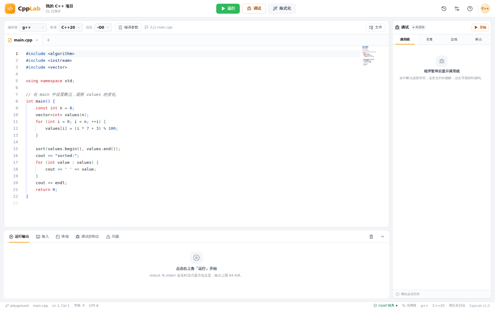
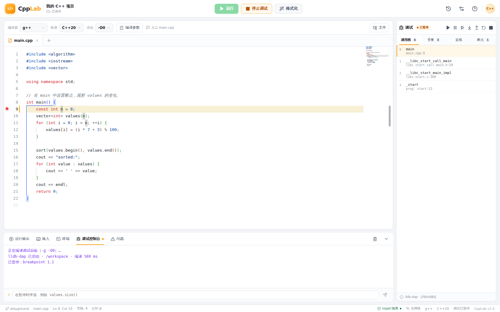

# CppLab · Online C++ IDE

A self-hosted online C++ edit / compile / run / graphical-debug platform. The UI follows a
LeetCode-style light workbench look; the backend is a single-process Node.js service, and all
user code (including the compile step) runs inside nsjail.

> **中文文档**: [README-zh_CN.md](README-zh_CN.md)





## Features

- **Editing**: Monaco Editor with C++ highlighting, bracket matching, auto-indent, code folding,
  minimap, and C++ snippet completion.
- **Multi-file**: file tabs, create / delete / switch the entry file, auto-saved to SQLite.
- **Compile & run**: g++ / clang++, C++17/20/23, optimization levels, a compiler-flag allowlist,
  stdin, streaming stdout/stderr.
- **Diagnostics**: parses `file:line:col: error:` diagnostics into Monaco markers; the
  "Problems" panel jumps to the location on click.
- **Formatting**: `clang-format` executed inside the sandbox with the built-in Google style
  (4 spaces, column limit 100).
- **Graphical debugging**: lldb-dap + DAP over WebSocket; line breakpoints, current-line
  highlight, call stack, lazily-loaded variable tree, Watch, debug-console REPL, and
  continue / pause / step over / step into / step out / restart / stop. The right-hand debug
  panel is resizable and collapsible; both width and collapsed state are remembered.
- **Run history**: every run stores a source snapshot, arguments, output, and status; any past
  run's code can be restored.
- **Bilingual UI**: the client and the server share one message catalog (English / 中文), so API
  errors, run phases and sandbox notes speak the same language as the interface. First visit
  follows the browser; switch any time in Settings → Language (kept in `localStorage`).
- **Multi-user accounts**: local accounts created by an administrator (no public registration),
  username/password login with scrypt, server-side sessions in an HttpOnly `SameSite=Strict`
  cookie, **one active device per account** (a new sign-in revokes the old session), forced
  password change, and per-account projects / history / debug sessions.
- **Isolation**: nsjail (namespaces + cgroup v2 + rlimits + seccomp), no network, read-only root
  filesystem, a fresh workspace per task, process-group reaping, output caps, global and
  per-account concurrency caps, and rate limiting.

## Quick start

Requirements: Linux, Node.js ≥ 22.5 (24 recommended), and a working `sudo`. `node:sqlite` is
built in from Node 22.5 on; the project uses no native addons. Verified on WSL2 / Ubuntu 26.04.

```bash
npm install                 # install dependencies
npm run sandbox:setup       # install clang / lldb / clang-format / dumb-init, build & install nsjail, create device nodes (calls sudo)
npm run build               # build the client to dist/client and the server to dist/server.js
npm run user:add -- alice --admin   # create the first administrator (interactive password)
npm start                   # single-process start, default http://127.0.0.1:3000
```

There is no anonymous registration: every account is created by an administrator, first via the
CLI and afterwards either via `npm run user:add` or `POST /api/admin/users`. The **first** account
adopts every project without an owner, including a legacy `playground` project. If ownerless
projects remain after accounts exist, business API requests fail closed with `503 ORPHAN_PROJECTS`.

Development mode (Vite HMR + tsx backend):

```bash
npm run dev                 # client at http://127.0.0.1:5173, API/WS proxied to 3000
```

> `sandbox:setup` installs `nsjail` as `4755` (setuid root) and creates 4 device nodes under
> `data/sandbox/dev/`. This is a simplification for a single-machine / intranet setup; if there
> are other untrusted local users on the host, prefer running the backend as root and restoring
> nsjail to normal permissions. See "Sandbox implementation notes".

### Environment variables

| Variable | Default | Description |
|---|---|---|
| `HOST` | `127.0.0.1` | Listen address; use `0.0.0.0` only behind HTTPS or on a trusted LAN |
| `PORT` | `3000` | HTTP/WebSocket port |
| `DB_PATH` | `data/cpplab.db` | SQLite path (password hashes and sessions live here) |
| `WORK_ROOT` | `$TMPDIR/cpplab-work` | Root of per-task scratch workspaces; tmpfs recommended |
| `NSJAIL_PATH` | auto-detect | nsjail executable |
| `SANDBOX_UID` | `10000` | Host UID used by jailed processes; must differ from the service UID |
| `SANDBOX_GID` | `10000` | Host GID used by jailed processes and sandbox device nodes |
| `LLDB_DAP_PATH` | auto-detect | lldb-dap path |
| `DUMB_INIT_PATH` | auto-detect | dumb-init path (exec directly if missing) |
| `CLANG_FORMAT_PATH` | auto-detect | clang-format path |
| `CLANGXX_PATH` | auto-detect | clang++ path |
| `SESSION_IDLE_HOURS` | `8` | Session idle timeout |
| `SESSION_ABSOLUTE_DAYS` | `7` | Session absolute lifetime |
| `COOKIE_SECURE` | `auto` | `auto` marks the cookie Secure only on HTTPS requests; `always` / `never` override |
| `TRUST_PROXY` | `0` | Number of trusted reverse-proxy hops. Never set this to `true` (it breaks IP limits) |
| `PUBLIC_ORIGIN` | — | Browser-visible origin behind a proxy, e.g. `https://cpp.example.com`, used for Origin checks |
| `ALLOW_BOOTSTRAP` | `0` | One-shot bootstrap: create the first admin from `BOOTSTRAP_ADMIN_*` while `users` is empty |
| `BOOTSTRAP_ADMIN_USERNAME` / `BOOTSTRAP_ADMIN_PASSWORD` | — | Only read when `ALLOW_BOOTSTRAP=1`; never logged |

### Accounts, transport and reverse proxy

```bash
npm run user:add -- alice --admin    # create an admin (prompts for the password)
npm run user:add -- bob              # ordinary user
npm run user:list
npm run user:passwd -- bob           # reset: prints a one-time password, forces a change
npm run user:disable -- bob          # or user:enable / user:role
```

- `data/` is tightened to `0700` and the SQLite files to `0600` at startup; back up the database
  before upgrades (it contains password hashes and source snapshots).
- For LAN or internet use, put the backend behind an HTTPS reverse proxy. Set
  `TRUST_PROXY=1`, `PUBLIC_ORIGIN=https://your.site`, and leave `COOKIE_SECURE=auto` (or force
  `always`). The proxy must forward `Cookie` and `Origin` headers and upgrade WebSocket requests.
  Missing `Origin` is rejected for state-changing HTTP requests; preserve it on WebSocket upgrades
  so cross-site browser connections can be checked.
- Non-browser API clients must send an `Origin` header matching the site for every state-changing
  request. Send `Content-Type: application/json` when the endpoint expects a JSON body.
- `TRUST_PROXY` is a hop count, not a boolean. Behind one nginx/Caddy, `TRUST_PROXY=1` lets
  Express read `X-Forwarded-For` / `X-Forwarded-Proto`; setting it to `true` would accept forged
  client IPs and defeat per-IP login limits.

## Architecture

```text
Browser (React + Monaco + DAP Client)
  ├─ REST: project/files, format, run requests, history
  └─ WebSocket: run output stream, DAP debug channel
                │
                ▼
Single-process Node.js (Express + ws + node:sqlite)
  ├─ Auth: scrypt passwords, auth_sessions (token hashes), HttpOnly cookies, Origin/CSRF checks
  ├─ Authorization: every project/run/debug query is scoped to the signed-in account
  ├─ Semaphore: compile ≤2 / run ≤4 / debug ≤2, plus ≤1 run / ≤1 debug per account
  ├─ Compile: nsjail → dumb-init → g++/clang++ → /workspace/prog
  ├─ Run:     nsjail → dumb-init → /usr/bin/time → /workspace/prog
  ├─ Debug:   nsjail → dumb-init → lldb-dap (stdio ↔ DAP WebSocket)
  └─ Rate limit: per IP 1 req/s, burst 5; run/format/debug-start per account; login IP/username windows + backoff
```

### Directory layout

```text
Server code lives in src/server:
  main.ts                 Express routes, WS upgrade, lifecycle
  runService.ts           run sessions, event stream, concurrency control
  sandbox/nsjail.ts       nsjail launch, timeouts, process-group kill, output truncation
  sandbox/config/*.cfg    three nsjail configs: compile / run / debug
  compile/flags.ts        compiler-flag allowlist (argv arrays, never shell strings)
  compile/diagnostics.ts  g++/clang++ diagnostic parsing
  compile/runner.ts       compile, run, format
  debug/session.ts        DAP sessions, idle/hard timeouts, protocol bridge
  auth/                   password hashing, sessions/cookies, login limiter, middleware, service
  db.ts                   SQLite users / sessions / projects / files / runs / debug sessions

src/client:
  App.tsx                 workbench state and interactions
  components/             TopBar, editor, bottom panel, debug sidebar, history drawer, dialogs
  editor/monaco.ts        theme, C++ snippets, language configuration
  debug/dapClient.ts      DAP client state machine, request timeouts, lazy loading
  components/AuthScreens.tsx  login, forced password change, account dialog
  storage.ts              per-account localStorage namespacing
  styles/app.css          LeetCode-style visual system

scripts/user-cli.mts      local account administration CLI
```

### API summary

| Method | Path | Purpose |
|---|---|---|
| `GET` | `/api/health` | public capability probe (no session data) |
| `POST` | `/api/auth/login` | public login (8 KiB body, IP + username limiter) |
| `GET` | `/api/auth/me` | current safe user |
| `POST` | `/api/auth/logout` | revoke the current session |
| `POST` | `/api/auth/password` | verify old password, revoke the current session, issue a replacement cookie |
| `GET/POST/PATCH` | `/api/admin/users[...]` | admin-only account create / list / status / role / reset |
| `GET` | `/api/project` | current account's project, files, capabilities |
| `PATCH` | `/api/project` | update entry / compiler / standard / optimization / name |
| `POST` | `/api/files` | save a single file |
| `DELETE` | `/api/files/*` | delete a file (entry file and the last file are protected) |
| `POST` | `/api/format` | clang-format inside the sandbox |
| `POST` | `/api/run` | 202 + `runId` + `wsPath` |
| `GET` | `/api/run/:id` | active run state or completed result |
| `GET` | `/api/runs` | run-history summaries |
| `GET` | `/api/runs/:id` | run detail (including source snapshot) |
| `POST` | `/api/runs/:id/restore` | restore a historical snapshot |
| `POST` | `/api/debug/start` | compile and create a debug session |
| `POST` | `/api/debug/:id/stop` | end a debug session explicitly |
| `WS` | `/ws/run/:runId` | run phases / stdout / stderr / final result |
| `WS` | `/ws/debug/:sessionId` | raw DAP JSON frames |

All `/api/*` routes except health and login require a valid session cookie. Cross-account
resources return `404` (not `403`) so IDs cannot be probed. WebSocket upgrades authenticate the
cookie and check the run/debug owner before attaching; close codes are `4401` (not signed in),
`4403` (not the owner) and `4404` (gone).

## Security model

The sandbox implementation provides these boundaries:

1. **Compilation also runs in the sandbox**: `compileWorkspace` uses the same nsjail launcher as
   the run path, with compile-specific cgroup quotas.
2. **Compiler-flag allowlist**: only `-g/-Wall/-Wextra/-Werror/-pthread/-lm/-D/-I/` plus the
   specified sanitizers are accepted; `-o`, `@file`, `-fplugin`, `-wrapper`, `-Xclang`,
   `-include`, etc. are explicitly rejected.
3. **Output cap**: the parent counts stdout+stderr and terminates the process tree immediately
   past `outputBytes` (64 KiB by default), marking the run `OLE`.
4. **Kill the process group**: nsjail is started with `setsid`; the watchdog first SIGTERMs the
   whole process group, then SIGKILLs by `/proc` parent-child relations so no init inside the
   pid namespace is left behind.
5. **No external network**: each jail gets a network namespace; compile/run seccomp policies also
   reject network socket syscalls. The debug policy allows the socket operations LLDB needs, but
   the namespace has no external route.
6. **Read-only rootfs + per-task workspace**: nsjail runs without `--rw`; the chroot rootfs is
   read-only, `/usr` is a read-only bind, and `/workspace` is a per-task writable bind. `/tmp` and
   `/dev/shm` inside the jail are tmpfs. Put `WORK_ROOT` on a tmpfs so the capacity limit is
   enforced by the kernel directly.
7. **no-new-privs + non-root**: nsjail enables `no_new_privs` by default and drops capabilities.
   User namespaces are disabled; jailed processes run as host UID/GID `10000` by default, which
   must differ from the service UID. `dumb-init` forwards signals as PID 1.

Multi-user layer:

- **Passwords**: Node's built-in `scrypt` (N=32768, r=8, p=1) with a per-password salt and a
  self-describing hash format, so parameters can be upgraded on the next login. Unknown
  usernames still pay for one scrypt run, keeping login timing uniform.
- **Sessions**: 32 random bytes, stored only as SHA-256 in `auth_sessions`; HttpOnly,
  `SameSite=Strict`, `Path=/`, `Secure` on HTTPS, 8-hour idle / 7-day absolute timeouts.
  Each account has exactly one active session: login/password change revoke the old session and
  insert the new one in one transaction (a unique partial index enforces the invariant), so a
  second device signs the first one out. Admin disables/resets revoke every session.
- **CSRF**: state-changing `/api` requests must carry a same-origin `Origin` (including login).
  Browser WebSocket upgrades validate `Origin`; non-browser clients may omit it but still require a
  valid session cookie.
- **Authorization**: the client never sends a project id. Every query uses the signed-in user's
  project, and run/debug sessions carry `ownerId`; cross-user access is `404`/`4403`.
- **Fairness**: per-account run/debug slots (`USER_BUSY` / `DEBUG_BUSY`) on top of the global
  semaphores, plus per-account request limits and login backoff.
- **Storage**: `data/` is `0700`, DB/WAL/SHM are `0600`; only token hashes and scrypt hashes are
  stored. Audit entries are line-bounded and rotated (10 MiB × 5).

Additional measures:

- A fresh temporary directory per run/debug task, removed on completion; debug sessions get a
  5-minute idle timeout, a 30-minute hard timeout, and a 1-hour nsjail backstop.
- Forged `/etc/passwd` and `/etc/group`; host `/home` and `/root` are never mounted.
- A seccomp denylist covering `mount/umount2/pivot_root/chroot/bpf/userfaultfd/io_uring` etc.;
  the debug config additionally allows `ptrace`.
- Run requests are validated for file count, total source size, stdin size, compiler enum, and
  the flag allowlist; SQLite stores text only.
- Audit log written to `data/runtime/audit.log` (login success/failure, session revocation, user
  changes, run/debug lifecycle, source hash); passwords, tokens and bodies are never logged.

### Sandbox implementation notes

Current configuration details:

| Area | Current behavior | Reason |
|---|---|---|
| Debug process limit | `pids_max=256` | Allows the lldb-dap thread pool to start |
| Root filesystem | Read-only chroot; `/workspace` and tmpfs mounts are writable | Jailed processes use a host UID distinct from the service account |
| `/dev` | tmpfs with host `data/sandbox/dev` device nodes bind-mounted into it | LLDB's launcher needs sandbox-owned device nodes, including `/dev/null` |
| Debug seccomp | Allows `ptrace`, selected identity changes, and required local socket operations | LLDB's fork launcher calls `setgid(getgid())`; its adapter also needs local IPC |
| Network syscalls | Compile/run/format seccomp rejects them; debug allows a restricted set in a network namespace with no external route | The smoke check asserts a connection attempt fails, without attributing it to one boundary |

Other limitations:

- Accounts are created by an administrator; there is no self-service registration, email reset,
  OIDC/LDAP or multi-project UI. An administrator cannot read another account's source by design.
- Plain HTTP on a LAN exposes passwords and session cookies. Use an HTTPS reverse proxy or
  `127.0.0.1` + an SSH tunnel; the default listener is `127.0.0.1` only.
- setuid nsjail means any local user on the host can execute nsjail; on multi-user hosts
  prefer running the backend as root.
- The sandbox runs as the configured host UID/GID (`SANDBOX_UID` / `SANDBOX_GID`), not in a
  user-namespace identity map. Keep the sandbox UID distinct from the service UID.
- Run workspaces live under the host `WORK_ROOT`. If it is not a tmpfs, `fsize`, task
  lifecycle, and cleanup still bound disk usage, but capacity is not kernel-enforced the way a
  true per-task tmpfs is.
- Debugging does **not support interactive stdin**. Programs reading `std::cin` will block
  while debugging — validate the logic via the "Input" panel first, or switch to fixed input
  before debugging.
- Unsupported features include clangd LSP, conditional breakpoints, `setVariable`, multi-thread
  UI, and `rr` reverse debugging.
- The sandbox's isolation ceiling is still the host kernel's syscall surface; the threat model
  accepts this.

## Resource limits (defaults)

| Dimension | Compile | Run | Debug |
|---|---|---|---|
| Wall clock | 20 s | 0.2–10 s (default 2 s) | 30 min hard timeout |
| Memory | 1024 MiB | 64–512 MiB (default 256) | 1024 MiB |
| pids | 64 | 14 | 256 |
| Output | 512 KiB | 64 KiB | DAP frames ≤8 MiB |
| File size | 256 MiB | 16 MiB | 1 GiB |
| nofile | 256 | 100 | 256 |
| Concurrency | 2 | 4 | 2 |
| Per-account concurrency | — | 1 | 1 |

## Testing

```bash
npm run build
node scripts/smoke-test.mjs
```

Optional sandbox/WebSocket regression checks:

```bash
node scripts/security-test.mjs
```

```bash
npm run test:unit           # password/session/authz/migration unit tests (node --test + tsx)
npm test                    # end-to-end smoke test (requires npm run build)
```

The smoke test boots an isolated backend with a temporary SQLite database, bootstraps an admin
through environment variables, and logs in for real (no auth bypass). It covers authentication
and cross-account authorization, sandboxed compile/run limits, formatting, DAP debugging,
history/restore, password changes, logout, and rate limiting. The exact check count can change
with the test suite.

Localization has two dedicated checks:

```bash
npm run i18n:check          # zh-CN and en catalogs share every key and placeholder, and no
                            # untranslated text hides in src / scripts / tests
# UI_USERNAME / UI_PASSWORD point at a real account on the running backend
BASE_URL=http://127.0.0.1:3000 UI_USERNAME=alice UI_PASSWORD=... npm run i18n:ui
```

More manual acceptance checklists live in [`tests/sandbox/README.md`](tests/sandbox/README.md)
and [`tests/debug/README.md`](tests/debug/README.md).

## Keyboard shortcuts

| Shortcut | Action |
|---|---|
| `Ctrl/⌘ + Enter` | Run |
| `F5` | Start debug / continue / pause |
| `Shift + F5` | Stop debugging |
| `F9` | Toggle breakpoint on the current line |
| `F10` / `F11` / `Shift + F11` | Step over / step into / step out |
| `Ctrl/⌘ + S` | Save now |
| `Ctrl/⌘ + Shift + F` | Format with clang-format |

## Known issues

- Programs reading `std::cin` block during a debug session (see above).
- When LLVM maps a breakpoint line to the next line, the breakpoint list keeps the line number
  the user set while its "verified" state is updated; the current execution line follows the
  stack frame returned by the debugger.
- For run/debug failures, check the bottom "Run Output" and "Debug Console" first; compile
  errors go to the "Problems" panel.

## References

- UI style: LeetCode-style workbench
- Account isolation: [`docs/multi-user-auth.md`](docs/multi-user-auth.md)
- Project history and superseded implementation notes: [`docs/HISTORY.md`](docs/HISTORY.md)

## License

[MIT](LICENSE)
